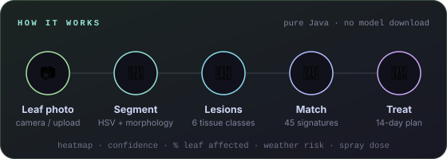
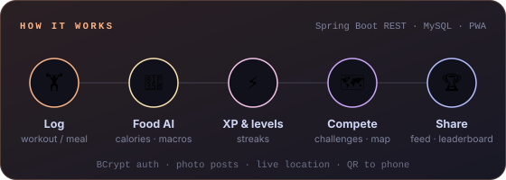
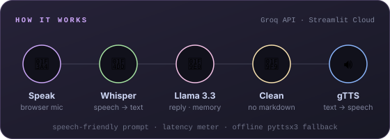

  

  

  
  
  

---

### 👋 About me

  

- 💼 Former **intern at HCLTech**, where I built **FitJanta** — now live in production.
- 🌱 I build **real, deployed apps** — from the MySQL schema to the UI to the cloud.
- 🤖 Exploring **AI in everyday products**: computer vision for farmers, smart nutrition for fitness.
- 🧩 Comfortable with **Agile / Scrum** teamwork — sprints, backlogs and user stories.

---

### 🚀 Featured projects

<table>
  <tr>
    <td width="50%" valign="top">
      
      
      
<b>CropDisease AI Pro</b> — an AI crop doctor for farmers.

      <ul>
        <li>🔬 Pure-Java <b>computer-vision engine</b> — finds lesions and draws a disease <b>heatmap</b></li>
        <li>🌾 <b>45 diseases · 11 crops</b> with organic + chemical treatment and a 14-day plan</li>
        <li>⛅ <b>7-day disease-risk forecast</b> from live weather</li>
        <li>🧮 Spray calculator · 🩺 symptom checker · 🤖 farm assistant · 📄 PDF reports</li>
      </ul>
      

        
        
      

    </td>
    <td width="50%" valign="top">
      
      
      
<b>FitJanta</b> — a social fitness app, built during my <b>HCLTech internship</b>.

      <ul>
        <li>🍛 <b>Food AI</b> — type a meal in plain words, get calories, macros and a health score</li>
        <li>⚡ <b>XP, levels, streaks</b> and ready-made challenges</li>
        <li>🗺️ <b>Live territory map</b> — see athletes nearby and claim areas</li>
        <li>📸 Photo feed · 💬 comments · 🏆 leaderboard · 📱 PWA</li>
      </ul>
      

        
        
      

    </td>
  </tr>
</table>

### 🤖 GenAI projects

<table>
  <tr>
    <td width="50%" valign="top">
      
    </td>
    <td width="50%" valign="top">
      
      
<b>Vani</b> — a voice assistant you talk to instead of typing.

      <ul>
        <li>🎤 <b>Whisper</b> speech-to-text → 🧠 <b>Llama 3.3 70B</b> (Groq) → 🔊 <b>gTTS</b> voice reply</li>
        <li>🌐 English · Hindi · Marathi · 🎭 4 personas · 💾 conversation memory</li>
        <li>⏱️ Latency meter · 📥 transcript export · 🛡️ offline TTS fallback</li>
      </ul>
      

        
        
      

    </td>
  </tr>
</table>

### 🧩 Agile & team projects

<table>
  <tr>
    <td width="50%" valign="top">
      
      
<b>College Event Management System</b> — led the team as <b>Project Lead</b>.

      <ul>
        <li>🗓️ Admins create and manage events; students register online</li>
        <li>📊 Participant dashboard for organisers</li>
        <li>⚙️ <b>GitHub Actions</b> CI workflow on every push</li>
      </ul>
      

    </td>
    <td width="50%" valign="top">
      
      
<b>Food Delivery App</b> — a complete Scrum cycle as a team.

      <ul>
        <li>📋 Product &amp; sprint backlogs using the <b>INVEST</b> principle</li>
        <li>🃏 <b>Planning poker</b> estimates · 📉 burn-down / burn-up charts</li>
        <li>🔁 Sprint retrospectives · ⚙️ CI demo with <b>GitHub Actions</b></li>
      </ul>
      

    </td>
  </tr>
</table>

---

### 🛠️ Tech stack

  
  
  
  
  

  
  
  
  
  

  
  
  

  
  
  
  
  

---

### 📈 What I'm working on

- [x] Ship **FitJanta** to a permanent cloud link
- [x] Build **CropDisease AI Pro** with computer vision in pure Java
- [x] Ship **Vani**, a GenAI voice assistant (Whisper + Llama 3 + gTTS), to a live link
- [ ] Train a CNN (PlantVillage) and plug it into CropDisease AI
- [ ] Multi-language (Hindi / Marathi) support for farmers

  

⭐ If you like a project, a star helps a lot — thanks for visiting!

