  

  
  &nbsp;
  

  
  
  

---

### 👋 About me

  

- 🌱 I build **real, deployed apps** — from the MySQL schema to the UI to the cloud.
- 🤖 Exploring **AI in everyday products**: computer vision for farmers, smart nutrition for fitness.
- 🧩 Comfortable with **Agile / Scrum** teamwork — sprints, backlogs and user stories.

---

### 🚀 Featured projects

<table>
  <tr>
    <td width="50%" valign="top">
      
      

        <b>CropDisease AI Pro</b> — an AI crop doctor. A pure-Java computer-vision engine finds leaf lesions,
        matches them to 45 disease signatures and builds an organic + chemical treatment plan.
        Also: 7-day weather disease-risk, spray calculator, symptom checker and a chat assistant.
      

      

        <a href="https://cropdisease-ai-pro.onrender.com">🔗 Live app</a> ·
        <a href="https://github.com/tjsss10/CropDisease-AI-Pro">📂 Code</a>
      

    </td>
    <td width="50%" valign="top">
      
      

        <b>FitJanta</b> — a social fitness app. Log workouts and meals (with an AI nutrition analyser),
        earn XP and levels, take on challenges, claim territory on a live map and climb the leaderboard.
        Installable on phones as a PWA.
      

      

        <a href="https://fitjanta.onrender.com">🔗 Live app</a> ·
        <a href="https://github.com/tjsss10/fitjanta">📂 Code</a>
      

    </td>
  </tr>
</table>

| Project | What it is | Tags |
|---|---|---|
| 🎓 [College Event Management System](https://github.com/tjsss10/college-event-management-system) | Agile project (PE-I): plan, register and manage college events | `agile` `scrum` |
| 🍔 [Food Delivery App](https://github.com/tjsss10/food-delivery-app) | Team Scrum simulation — product backlog, sprint backlog, cart feature notes | `scrum` `team` |

---

### 🛠️ Tech stack

  
  
  
  
  

  
  
  
  
  

  
  
  
  
  

---

### 📈 What I'm working on

- [x] Ship **FitJanta** to a permanent cloud link
- [x] Build **CropDisease AI Pro** with computer vision in pure Java
- [ ] Train a CNN (PlantVillage) and plug it into CropDisease AI
- [ ] Multi-language (Hindi / Marathi) support for farmers

  

⭐ If you like a project, a star helps a lot — thanks for visiting!

